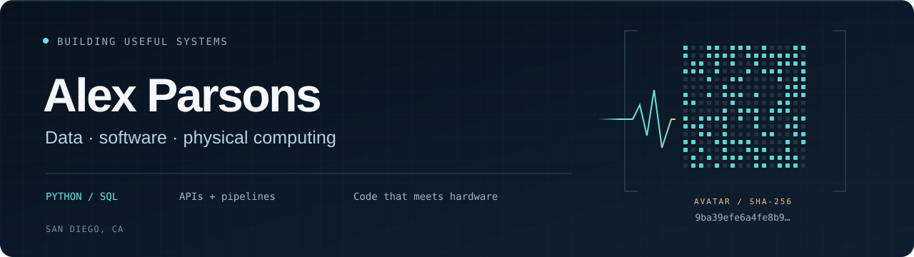
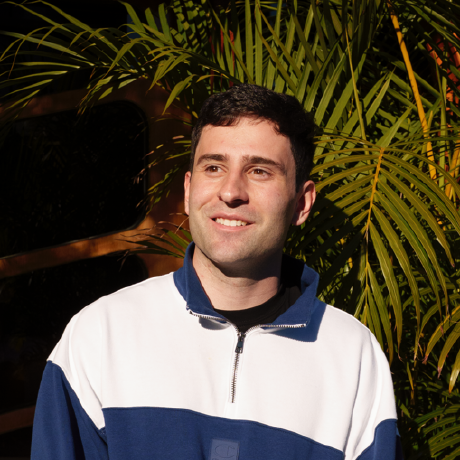

**I build software that connects data to the real world.**

I’m a San Diego–based software engineer with a background in data engineering, governance, and analytics. At **Blooio**, I build integrations, web features, and internal tools. Previously, I worked on metadata and data quality at **ICW Group** and logistics optimization at **Sony**.

I like projects where the details matter: traceable data, reliable APIs, and software that works with physical devices.

[Portfolio](https://alexwastaken.com) · [LinkedIn](https://www.linkedin.com/in/ahparsons/) · [Email](mailto:alexhparsons@gmail.com)

 

## Selected projects

### ☄️ [Meteor Echo Station](https://github.com/alexwastaken/meteor-scatter-sdr)

A receive-only radio observation app that turns raw SDR signals into inspectable, **unconfirmed meteor-echo candidates**.

- **The engineering:** live signal processing, a bounded I/Q buffer, interference checks, and a browser interface for inspecting candidate events.
- **The data discipline:** raw captures, structured metadata, and SHA-256 integrity hashes; simulated training data stays separate from physical observations.
- **Built with:** Python · NumPy · RTL-SDR · Raspberry Pi

### 🤖 [DroidFun](https://github.com/alexwastaken/DroidFun)

Desktop software and firmware for small USB desk companions with expressive OLED screens, custom faces, and useful live information.

- **The engineering:** a desktop controller, exact 128 × 64 screen previews, USB device communication, and RP2040 firmware.
- **The product details:** configurable widgets, bounded requests and caching, bot themes, and native packaging for macOS, Windows, and Linux. Platform verification and remaining hardware checks are documented in the repository.
- **Built with:** React · TypeScript · Rust · Tauri · RP2040

## What I work with

| Area | Tools & experience |
| :--- | :--- |
| Data & integration | Python, SQL, REST APIs, ETL / ELT, Docker |
| Governance & quality | Alation, metadata management, lineage, Snowflake data quality |
| Applications & platforms | JavaScript / TypeScript, Cloudflare Workers, D1, AWS, SQL Server |

**Open to data engineering roles · San Diego, CA · Open to relocation**

The banner’s bit grid encodes the SHA-256 hash of my profile photo: a small nod to identity and data provenance.
